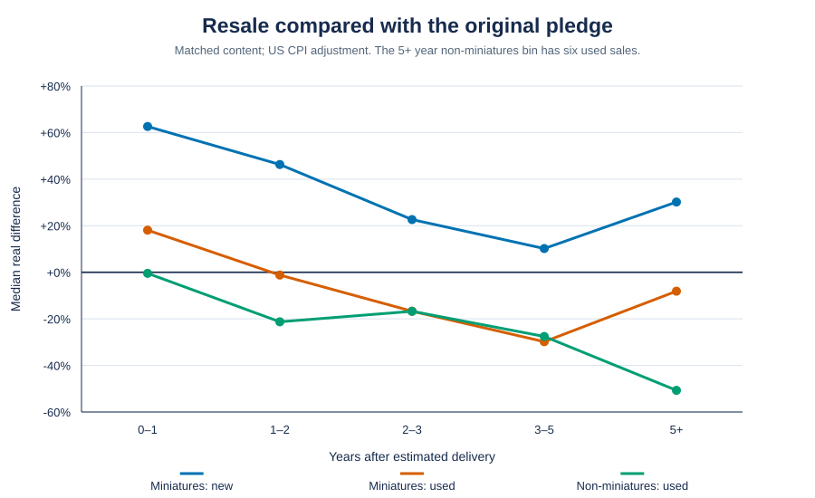
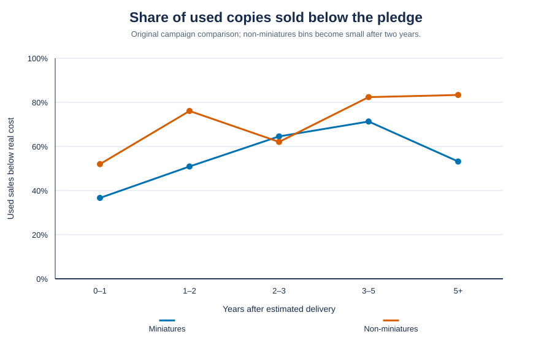
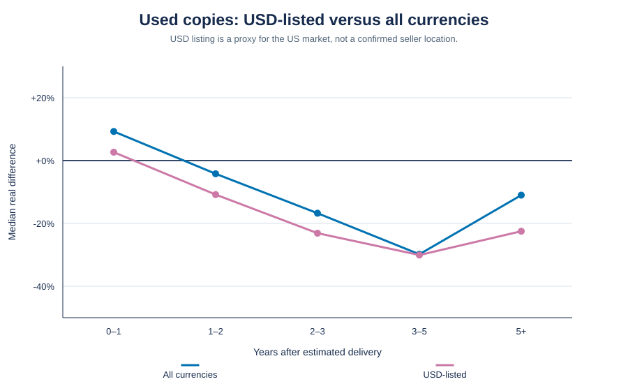
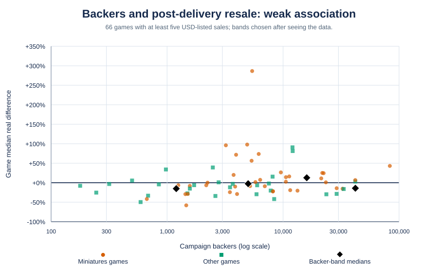
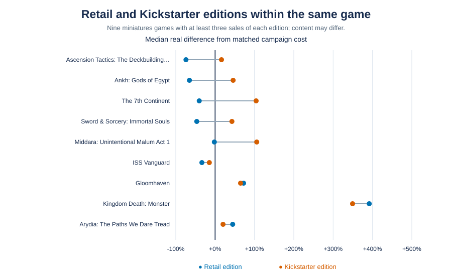

# Should you back the big board game now, or buy it later?

A large crowdfunding campaign can make a pledge feel like the last affordable chance to get a game. The resale record suggests a simpler rule: **if you are willing to buy used and wait, the typical copy gets cheaper.** A sealed copy soon after delivery usually costs more. Some games remain expensive, and a low resale price does not guarantee that a copy will be easy to find.

There are two ways to wait, and they buy different things. A **used Kickstarter-edition copy** can contain the same campaign extras and exclusives as a backer's copy. A **retail edition** may cost much less, but it may also leave those extras out. Compare the contents before comparing prices.

## What the sales show

The main comparison uses 3,132 clean second-hand marketplace sales on BoardGameGeek for 73 large miniatures games. Each sale is compared with the original campaign cost of the matched contents, in US dollars. The real-dollar comparison adjusts the earlier pledge for US inflation through the month of the sale. Shipping is excluded from both prices.

In the first year after estimated delivery, a used copy sold for a median **18% above** the inflation-adjusted original pledge. At one to two years, the median was **1% below**; at two to three years, **17% below**. Sealed copies stayed more expensive: their medians were **63% above** in the first year and **46% above** in the second. The late sealed-copy bins are small and can be dominated by a few games.

For used miniatures copies, the share of sales below the real pledge rose from **37%** in the first year to **51%** at one to two years, **65%** at two to three years, and **71%** at three to five years. A buyer looking for a particular game may still face a very different price.

The pattern is not confined to miniatures. A separate group of **23 large non-miniatures games**, with **433 clean sales**, had a median game resale result of **6% below** the real pledge after delivery; **17 of 23** games were below. Used sales reached a median **21% below** at one to two years. This smaller group has thin sales for several titles, so it is a check on the direction of the result, not a precise price forecast.

## Where you buy matters

The marketplace does not identify every seller's country. Sales listed in USD are a rough proxy for the US market. For miniatures games, the median of post-delivery game medians was **4% below** the real pledge for USD-listed sales, versus **1% above** when all listing currencies were included. The USD-only sample has **1,978 sales in 72 games**; the full sample has **3,132 in 73**. At one to two years after delivery, used copies were a median **7% below** cost in the USD-listed group and **1% below** across all currencies.

Recent eBay sold listings from July through September 2026 offer a separate check using base games rather than matched bundles. Across **151 sales**, the median was **11% below** the original core pledge before inflation and **26% below** after inflation. That is a snapshot of recent listings, not a full price history.

## Does campaign size predict a bargain?

Only weakly. Among **55 miniatures games** with at least five USD-listed sales after delivery, the rank correlation between backer count and a game's median resale result was **+0.24**; the statistical test gave **p = .08**. All **nine** games with fewer than 2,000 backers had medians below cost, with a group median of **29% below**. The larger groups did not rise steadily: the 2,000–9,999 group was at **0%**, the 10,000–24,999 group at **+13%**, and the 25,000-plus group at **−14%**.

The 2,000-backer dividing line was chosen after seeing the sales, and smaller campaigns tend to be newer. More backers also meant more USD-listed sales per year, with a **+0.48** rank correlation. The smallest group had a median of only **3.3 USD-listed sales per year**. Cheap and available are different things.

## Used campaign copy or retail box?

For nine miniatures games with enough sales of both editions, retail-edition copies sold a median **52% below** Kickstarter-edition copies within the same game; retail was cheaper in **six of nine**. Retail-edition sales were observed for about half the games in the broader retail comparison. The large gaps usually accompany missing campaign extras or stretch goals. When the content was effectively identical, there was no clear discount. A retail box is therefore an option only if one exists and its contents suit you.

Reprints can change the price of a Kickstarter-edition copy too. In this sample, resale prices fell after reprint campaigns even after accounting for a game's age. Publishers are more likely to reprint games with demand, so this pattern does not prove a reprint will happen for a particular game.

## A practical rule

If you want the campaign contents but can tolerate a used box, start looking about **1½–2 years after delivery**. Compare the exact edition and included extras, and set a price alert early for small-run games. If you are happy with the retail contents, check whether a retail edition exists; it can be cheaper much sooner. Backing makes most sense when early access and a sealed copy matter enough to justify the higher typical price and the risk of delay or non-delivery.

The clock starts earlier for a backer. In these campaigns, delivery was roughly **two years after the campaign ended**, so buying a used copy below the real pledge often means waiting **three to four years from the pledge date**. The backer is paying partly for earlier access.

These are observed resale prices, not guaranteed offers. Games that never arrived or stopped trading are underrepresented. Some sale bins contain few games or sales; listing currencies do not establish seller location. The analysis leaves out shipping on both sides and does not price unmatched add-ons. Inflation is measured with US CPI even for sales originally listed in other currencies. A current buyer should compare the actual delivered cost and contents of the available listing with the pledge they would have made.
